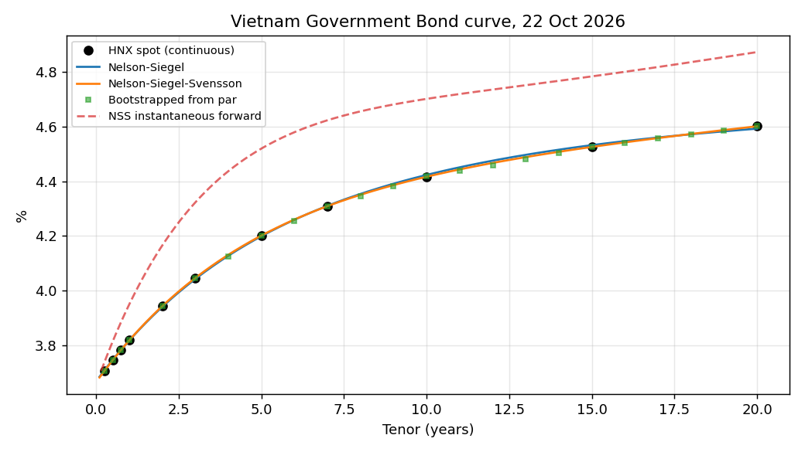

# VN Treasury Quant Lab

Tools I built to work through the main problems a bank treasury desk deals with in Vietnam: building the government bond curve, measuring rate risk, pricing USD/VND forwards, FX options and VND swaps, and checking whether FX and short rates can be forecast. All of it runs on public data (HNX, US Treasury, IMF, Yahoo Finance) and can be rebuilt from scratch with the scripts below.



## Main results

- HNX's daily government curve can be reproduced almost exactly with a Nelson-Siegel-Svensson fit (mean error 0.04bp over 1,697 days), and bootstrapping HNX's own par yields gives back their spot curve to within 0.2bp.
- For an illustrative VND 100bn bond portfolio, DV01 is about VND 63m per bp, a 100bp parallel rise costs about VND 6.1bn, and 10-day 99% historical VaR is about VND 3.9bn.
- In a 1-day VaR backtest over 1,445 days, historical simulation passes both the Kupiec and Christoffersen tests at 99%. A normal EWMA model does not: it has 32 exceptions against 14 expected, because daily rate moves have fat tails.
- Hedging the bond book with a single 10Y swap removes the parallel DV01 but leaves almost all of the curve risk. Using 5Y and 10Y swaps cuts the remaining key-rate exposure by about 70%.
- Since 2020, the 1Y USD/VND forward has pointed the wrong way. It priced VND appreciation of about 1% a year, while VND actually weakened by about 2% a year.
- No model I tried beats a simple drift forecast for USD/VND one or three months ahead. VND short rates are different: they move in trends, so a basic AR model cuts forecast error by about 30% against a random walk.

## Reports

| Report | Contents |
|---|---|
| [Curve and rate risk](reports/summary.md) | Curve fitting, data quality, PCA, portfolio DV01 and key-rate DV01, scenarios, historical VaR and its backtest |
| [Treasury pricing](reports/pricing.md) | CIP forward table, forward vs realised USD/VND, FX forward MTM, Garman-Kohlhagen greeks, swap hedging |
| [Forecasting](reports/forecast.md) | What drives USD/VND, out-of-sample FX and short-rate forecasts |

## Code

| Module | What it does |
|---|---|
| `vntql/data.py` | Downloads and caches the HNX daily curve (11 tenors from 3M to 20Y) and handles a known data problem from October 2024 |
| `vntql/curves.py` | Nelson-Siegel and Svensson fitting, bootstrapping zero rates from par yields, discount factors and forwards |
| `vntql/bonds.py` | Bond pricing off a curve, yield, duration, convexity, DV01 and key-rate DV01, scenario P&L with full revaluation |
| `vntql/pca.py` | PCA of curve changes and PCA-based stress scenarios |
| `vntql/risk.py` | Historical and EWMA VaR, Kupiec and Christoffersen backtests, Basel traffic light |
| `vntql/market.py` | US Treasury curves (bootstrapped) and USD/VND history |
| `vntql/fx.py` | CIP forwards, FX forward valuation, spot delta and DV01 to each curve |
| `vntql/options.py` | Garman-Kohlhagen prices and greeks, implied vol, strike from delta |
| `vntql/swaps.py` | Fixed-float swaps: par rate, PV, DV01, key-rate DV01 |
| `vntql/macro.py` | DXY, USD/CNY and Brent from Yahoo; Vietnamese and US CPI and Vietnamese trade from the IMF API |
| `vntql/forecast.py` | Walk-forward testing with no look-ahead, OLS and ridge, Clark-West test, Newey-West regressions |

There are 31 unit tests. They check the greeks against finite differences, put-call parity, that a par swap equals a par bond, the backtest statistics against their formulas, and that the walk-forward never uses future data.

## Notes on the data and methods

The HNX curve is a fitted curve, not raw prices. Daily changes have negative autocorrelation (-0.1 to -0.4), which looks like refit noise, so PCA and multi-day VaR use 20-day and 10-day changes. In the autumn of 2024 the long end drifted from 2.6% to 3.9% with the 2Y flat and then snapped back on 22 October; windows that cross that date are dropped.

There is no free source for VND interbank rates or quoted USD/VND forward points (the SBV website blocks scripts), so the government curve stands in for VND funding rates. Forwards here are therefore theoretical and leave out the cross-currency basis. Option vols are realised vols, because implied vols are not published.

Yahoo's daily USD/VND history before 2021 has many one-day off-market prints. Monthly series use the median of the last five closes of each month. Macro data enter with a two-month lag, which is roughly when they become public.

## Running it

```bash
pip install -r requirements.txt
python scripts/fetch_hnx.py 2020-01-01   # HNX curve, about 15 minutes the first time
python scripts/fetch_market.py           # US Treasury curves and USD/VND
python scripts/fetch_macro.py            # DXY, USD/CNY, Brent, CPI, trade
python scripts/report.py                 # curve and rate risk
python scripts/pricing_report.py         # treasury pricing
python scripts/forecast_report.py        # forecasting
python -m pytest -q
```

Rates are decimals, zero rates are continuously compounded, tenors are in years, and VGB coupons are annual.

## Next steps

- Fit the curve to traded VGB prices instead of HNX's fitted output.
- Use quoted forward points and interbank rates, when I can get them, to measure the USD/VND basis.
- Add the SBV central rate and FX reserves to the forecasting work.

Data: [HNX yield curve](https://hnx.vn/trai-phieu/duong-cong-loi-suat.html), [US Treasury par yields](https://home.treasury.gov/resource-center/data-chart-center/interest-rates), [IMF data](https://data.imf.org), Yahoo Finance. For research and learning only.
