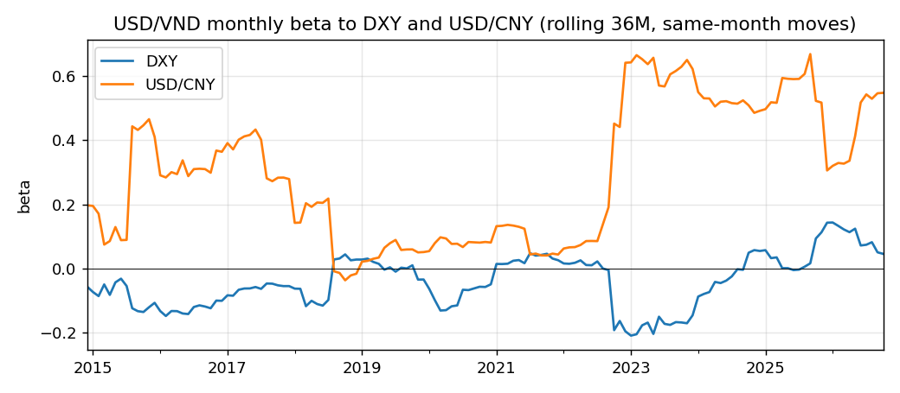
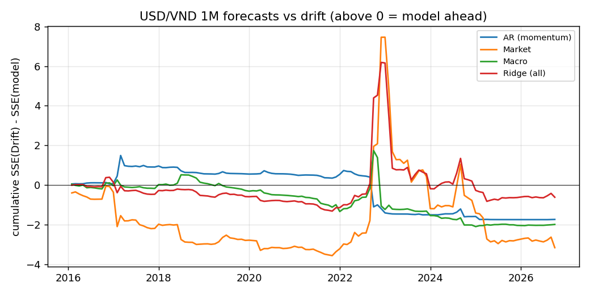
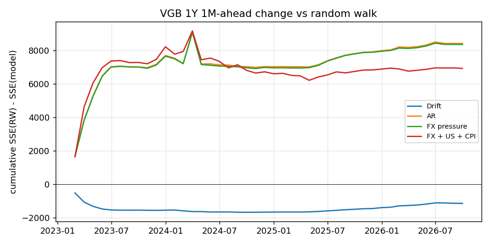

# Forecasting USD/VND and VND Short Rates
Monthly data 2012-01 to Oct 2026. USD/VND month-end = median of the month's last 5 daily closes (Yahoo's history has one-day off-market prints). Macro data (IMF: CPI, goods trade) enter with a 2-month publication lag. All forecasts are **out of sample**: expanding window, refit every month, using only data available at the forecast date.

## 1. What moves USD/VND (same-month, in-sample)
Regression of the monthly USD/VND log change (%) on same-month DXY and USD/CNY changes (%) and the change in the US 2Y yield (bp); Newey-West t-stats, n = 178, R² = 0.19.

|         |   coef |   t (NW) |
|:--------|-------:|---------:|
| const   |  0.092 |    1.75  |
| dxy1    | -0.073 |   -1.376 |
| usdcny1 |  0.311 |    3.078 |
| d_ust2y |  0.01  |    2.908 |

Latest 36M betas: DXY 0.05, USD/CNY 0.55. This is a description, not a forecast: it maps a USD or CNY scenario into a USD/VND scenario.

## 2. Forecasting USD/VND (1M and 3M ahead)
Benchmark: **drift** (the trailing mean change; USD/VND has risen 1.4% a year on average since 2012 under the SBV's managed crawl). The pure random walk (no change) is also shown. CW = Clark-West test of the model against the nested drift benchmark (one-sided p).

**1M ahead** (128 out-of-sample months, Jan 2016 to Sep 2026):

|               |   RMSE |   RMSE / Drift |   OOS R2 vs Drift % |   hit rate % |    CW t |    CW p |
|:--------------|-------:|---------------:|--------------------:|-------------:|--------:|--------:|
| RW            |  0.948 |          1.005 |              -1.097 |      nan     |   0.082 |   0.467 |
| Drift         |  0.943 |          1     |               0     |       50     | nan     | nan     |
| AR (momentum) |  0.95  |          1.008 |              -1.532 |       48.438 |  -0.479 |   0.684 |
| Market        |  0.956 |          1.014 |              -2.786 |       47.656 |   0.698 |   0.243 |
| Macro         |  0.951 |          1.009 |              -1.755 |       50     |  -0.229 |   0.591 |
| Ridge (all)   |  0.945 |          1.003 |              -0.548 |       46.875 |   0.529 |   0.299 |

**3M ahead** (overlapping, 124 months; CW uses Newey-West with 2 lags):

|               |   RMSE |   RMSE / Drift |   OOS R2 vs Drift % |   hit rate % |    CW t |    CW p |
|:--------------|-------:|---------------:|--------------------:|-------------:|--------:|--------:|
| RW            |  1.612 |          1.022 |              -4.464 |      nan     |   0.026 |   0.49  |
| Drift         |  1.577 |          1     |               0     |       56.452 | nan     | nan     |
| AR (momentum) |  1.613 |          1.023 |              -4.592 |       55.645 |  -0.539 |   0.705 |
| Market        |  1.604 |          1.017 |              -3.461 |       50     |   1.031 |   0.151 |
| Macro         |  1.622 |          1.028 |              -5.747 |       56.452 |  -0.402 |   0.656 |
| Ridge (all)   |  1.599 |          1.014 |              -2.781 |       50     |   0.271 |   0.393 |

Models: AR = own past change; Market = past 1M changes in DXY, USD/CNY, US 2Y yield and USD/VND; Macro = VN-US inflation differential and 12M goods trade balance (% of trade); Ridge = all of these plus Brent, penalty chosen by rolling validation inside each training window.

## 3. Forecasting VND short rates (VGB 1Y, 1M ahead)
HNX government 1Y spot rate as a proxy for VND short-term funding (interbank data is not publicly downloadable). Benchmark: random walk. FX pressure = past 3M USD/VND change, testing the SBV channel of defending the currency by tightening VND liquidity.

Out of sample 44 months, Feb 2023 to Sep 2026:

|               |   RMSE |   RMSE / RW |   OOS R2 vs RW % |   hit rate % |    CW t |    CW p |
|:--------------|-------:|------------:|-----------------:|-------------:|--------:|--------:|
| RW            | 19.51  |       1     |            0     |      nan     | nan     | nan     |
| Drift         | 20.171 |       1.034 |           -6.883 |       59.091 |  -1.267 |   0.897 |
| AR            | 13.755 |       0.705 |           50.298 |       77.273 |   3.255 |   0.001 |
| FX pressure   | 13.8   |       0.707 |           49.967 |       77.273 |   3.249 |   0.001 |
| FX + US + CPI | 14.935 |       0.765 |           41.402 |       86.364 |   2.868 |   0.002 |

In-sample check, 2020 onward (n = 80): next-month change in VGB 1Y (bp) on this month's change (bp) and the past 3M USD/VND change (%):

|         |   coef |   t (NW) |
|:--------|-------:|---------:|
| const   |  0.244 |    0.106 |
| d_vgb1y |  0.627 |    4.822 |
| fx3     |  0.598 |    0.334 |

## 4. What I take from this
None of the models beat the drift forecast for USD/VND. The best 1M model is 1.003 times the drift's error, and the lowest Clark-West p-value across 1M and 3M is 0.15. The market model only did well around the late-2022 sell-off and lost that edge afterwards. With public data, monthly moves in a managed currency look unpredictable.

USD/VND moves with USD/CNY much more than with DXY. Over the last three years the beta to USD/CNY is about 0.5, and DXY adds little once CNY is in the regression. For stress scenarios, a CNY shock is the more useful input.

Short rates are a different story. Monthly changes in the VGB 1Y rate have an autocorrelation of 0.66, so a plain AR model cuts the forecast error by about 30% compared with assuming no change. Most of the gain comes from the 2023 easing cycle, and HNX's curve fitting may smooth rates on its own, so I would use this for risk forecasts rather than as a trading signal.

Past USD/VND weakness does predict higher short rates when used alone, but the effect goes away once the rate's own trend is included, and it does not improve the out-of-sample forecasts.
