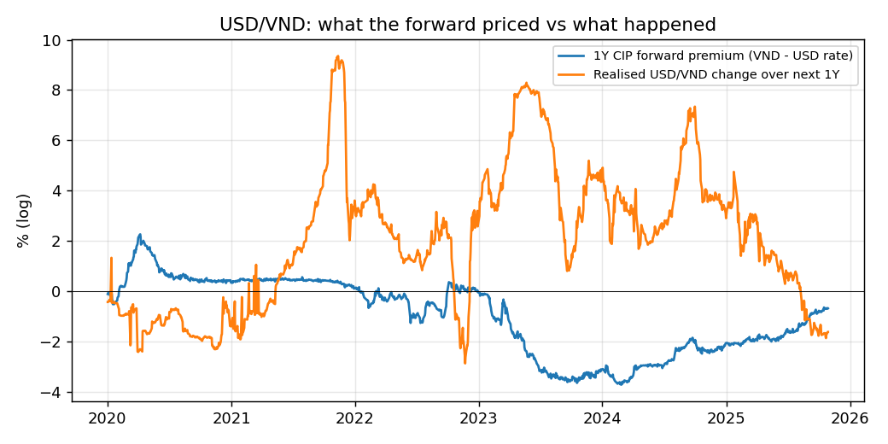

# Treasury Pricing: USD/VND Forwards, FX Options, VND Swaps
Valuation date 21 Oct 2026. USD/VND spot 25,856 (Yahoo). USD curve: US Treasury CMT, bootstrapped. VND curve: HNX government bond curve, used as a **proxy** for VND funding rates (the interbank / deposit curve and quoted forward points are not publicly downloadable), so forwards here are CIP-theoretical, without cross-currency basis.

## 1. CIP forwards
| tenor   |   VND zero % |   USD zero % |   forward |   points |   premium % p.a. |
|:--------|-------------:|-------------:|----------:|---------:|-----------------:|
| 1M      |         3.72 |         4.05 |   25848.8 |    -7.19 |            -0.33 |
| 3M      |         3.72 |         4.21 |   25824.3 |   -31.67 |            -0.49 |
| 6M      |         3.75 |         4.3  |   25784.8 |   -71.2  |            -0.55 |
| 1Y      |         3.82 |         4.47 |   25688.7 |  -167.34 |            -0.65 |
| 2Y      |         3.94 |         4.76 |   25435.8 |  -420.2  |            -0.82 |
| 5Y      |         4.19 |         4.9  |   24959.7 |  -896.34 |            -0.71 |

Forward points are negative when VND rates are below USD rates: USD trades at a forward discount.

## 2. Did the forward predict USD/VND? (1Y, 2020 onward)

|                                        |    value |
|:---------------------------------------|---------:|
| observations (overlapping daily)       | 1226     |
| mean 1Y forward premium %              |   -0.98  |
| mean realised 1Y change %              |    2.055 |
| correlation                            |   -0.513 |
| regression slope (realised on premium) |   -0.951 |
| regression intercept %                 |    1.122 |
| long USD fwd: mean return %            |    3.08  |
| long USD fwd: hit rate %               |   71.37  |

Under uncovered interest parity the slope would be 1 and the intercept 0. For a managed currency like VND the realised path is driven by SBV policy and the USD cycle rather than the rate differential. Caveats: overlapping 1Y windows (about 5 independent observations), a sample dominated by the 2022-2025 VND depreciation, and government-curve proxies for funding rates.

## 3. FX forward mark-to-market
Bought USD 10m 1Y forward on 21 Apr 2026 at 26,303.1 (spot then 26,325). Today, 0.50y later:

|                              | value        |
|:-----------------------------|:-------------|
| MTM (VND m)                  | -5,085.54    |
| spot delta (USD)             | 9,787,710.82 |
| DV01 to VND curve (VND m/bp) | -12.87       |
| DV01 to USD curve (VND m/bp) | 12.62        |

## 4. FX options (Garman-Kohlhagen, 6M, USD 1m notional)
Vol = 1Y realised USD/VND vol 2.23% (no public implied-vol quotes). rd = 3.752%, rf = 4.303% (continuous).

|              |   strike |   premium (VND/USD) |   premium % of spot |   delta |   gamma (per 1M USD) |   vega (VND m, 1 vol pt) |   theta (VND m/day) |   rho VND (VND m/bp) |   rho USD (VND m/bp) |
|:-------------|---------:|--------------------:|--------------------:|--------:|---------------------:|-------------------------:|--------------------:|---------------------:|---------------------:|
| ATMF call    |  25784.8 |             159.145 |               0.616 |   0.492 |              957.899 |                   71.384 |              -0.227 |                0.629 |               -0.637 |
| ATMF put     |  25784.8 |             159.145 |               0.616 |  -0.486 |              957.899 |                   71.384 |              -0.61  |               -0.637 |                0.629 |
| 25d USD call |  26056.7 |              60.733 |               0.235 |   0.25  |              771.731 |                   57.51  |              -0.247 |                0.32  |               -0.323 |
| 25d USD put  |  25522.1 |              61.705 |               0.239 |  -0.25  |              771.731 |                   57.51  |              -0.443 |               -0.326 |                0.323 |

## 5. VND interest rate swaps and hedging the bond portfolio
Single-curve valuation on the VND proxy curve (annual fixed vs quarterly floating). Par rates: 2Y par swap % 4.016, 5Y par swap % 4.269, 10Y par swap % 4.480, 15Y par swap % 4.583.

Project 1's illustrative VND 100bn bond portfolio hedged with payer swaps. Key-rate DV01 = value change for a +1bp bump, VND m:

|       |   Bonds |   + 10Y payer |   + 5Y/10Y payers |   + 2/5/10/15Y payers |
|------:|--------:|--------------:|------------------:|----------------------:|
|  0.25 |   -0    |          0    |              0    |                     0 |
|  1    |   -0.42 |         -0.09 |             -0.13 |                    -0 |
|  2    |   -4.5  |         -3.86 |             -3.94 |                     0 |
|  3    |   -1.54 |         -0.04 |             -0.22 |                     0 |
|  5    |  -14.72 |        -11.95 |              0.08 |                    -0 |
|  7    |   -3    |          1.57 |             -0.75 |                     0 |
| 10    |  -26.25 |         27.29 |              0.11 |                    -0 |
| 15    |  -12.92 |        -12.92 |            -12.92 |                    -0 |
| 20    |   -0    |          0    |              0    |                     0 |

Payer swap notionals (VND bn):

|                              |   notional |
|:-----------------------------|-----------:|
| 10Y (DV01 hedge)             |       76.7 |
| 5Y (5Y/10Y key-rate hedge)   |       31.3 |
| 10Y (5Y/10Y key-rate hedge)  |       37.8 |
| 2Y (matched-maturity hedge)  |       20   |
| 5Y (matched-maturity hedge)  |       30   |
| 10Y (matched-maturity hedge) |       35   |
| 15Y (matched-maturity hedge) |       15   |

A single 10Y swap removes the parallel DV01 (gross key-rate exposure 63.3m -> 57.7m) but leaves offsetting curve risk: net short duration at 10Y, net long at 2Y/5Y/15Y. Using only the liquid 5Y and 10Y swaps to match key rates leaves 18.1m. Matched-maturity swaps hedge exactly (notionals equal the bond faces) because, on a single curve, a par bond is a receiver swap plus a floating-rate note: a consistency check on the pricers.
