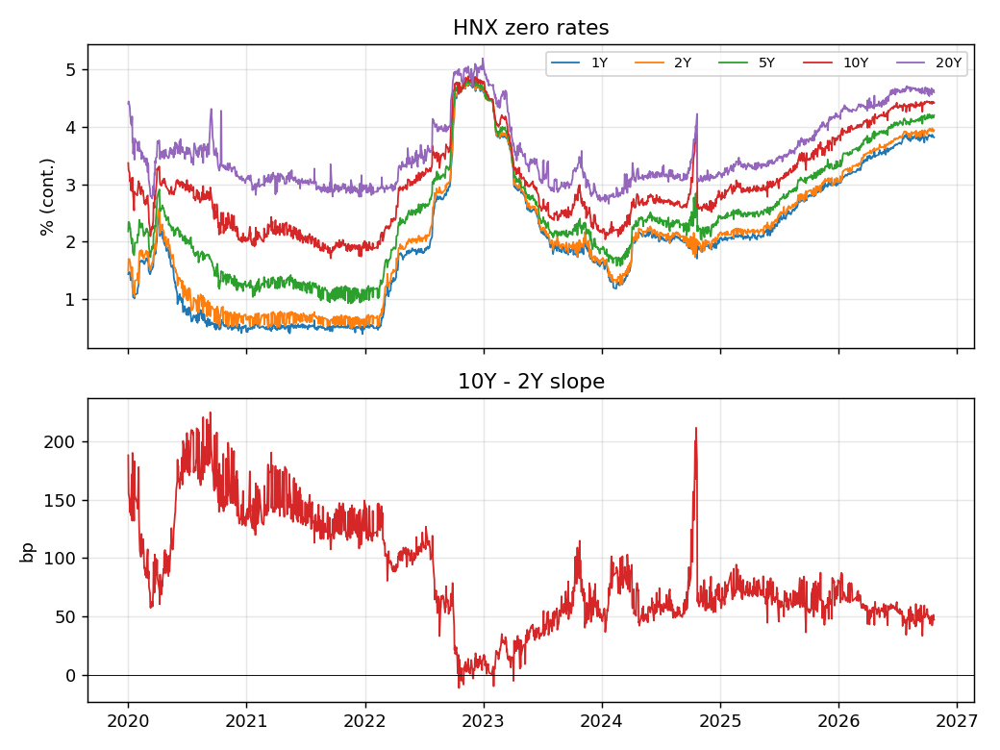
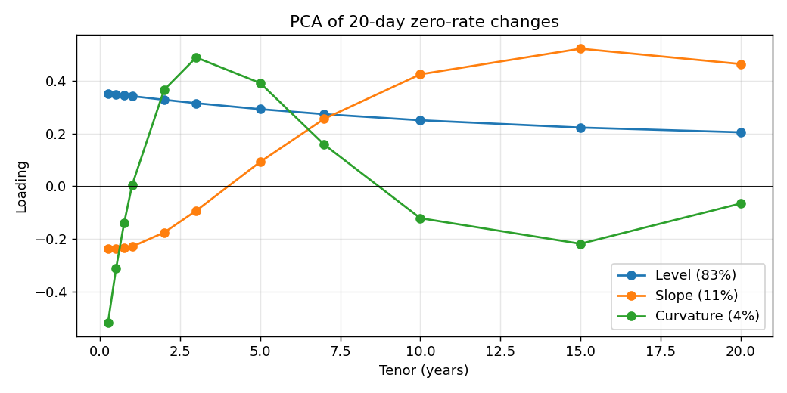
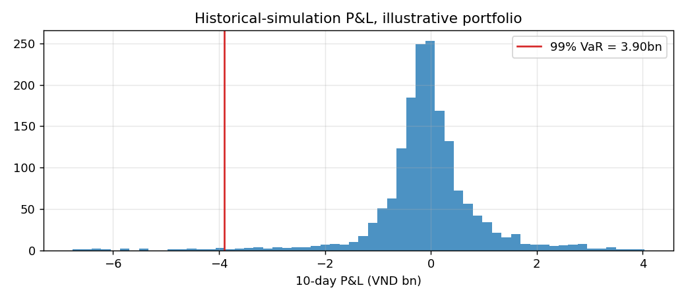
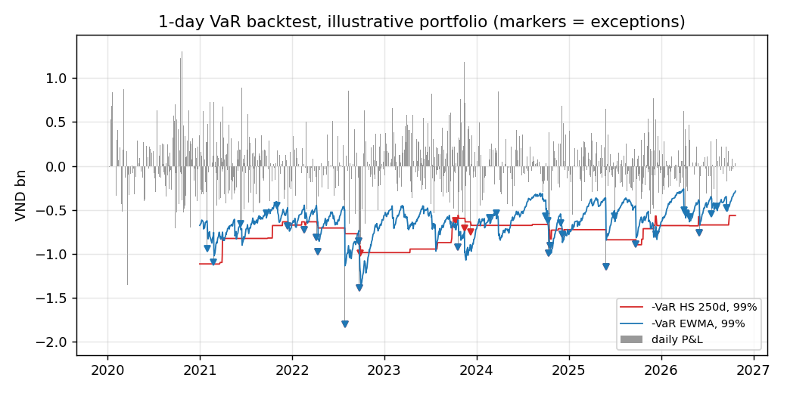

# Vietnam Government Bond Curve & Rate Risk Report
Data: HNX daily yield curve, 02 Jan 2020 to 22 Oct 2026 (1697 days).

## 1. Curve construction (latest day)

NSS parameters: beta = [5.232, -1.568, 5.66, -5.869] (%), lambda = [6.4, 7.42]

|   tenor |   HNX spot % |   NS % |   NSS % |   Bootstrap % |   NSS err bp |   Boot err bp |
|--------:|-------------:|-------:|--------:|--------------:|-------------:|--------------:|
|    0.25 |        3.706 |  3.708 |   3.706 |         3.706 |           -0 |         0     |
|    0.5  |        3.745 |  3.746 |   3.745 |         3.745 |           -0 |         0     |
|    0.75 |        3.782 |  3.783 |   3.782 |         3.782 |            0 |        -0     |
|    1    |        3.818 |  3.817 |   3.818 |         3.818 |            0 |         0     |
|    2    |        3.943 |  3.94  |   3.943 |         3.943 |            0 |        -0     |
|    3    |        4.046 |  4.043 |   4.046 |         4.046 |           -0 |         0     |
|    5    |        4.202 |  4.199 |   4.202 |         4.202 |           -0 |         0.027 |
|    7    |        4.309 |  4.311 |   4.309 |         4.31  |           -0 |         0.04  |
|   10    |        4.417 |  4.424 |   4.417 |         4.418 |            0 |         0.077 |
|   15    |        4.526 |  4.533 |   4.526 |         4.528 |           -0 |         0.161 |
|   20    |        4.602 |  4.593 |   4.602 |         4.604 |            0 |         0.174 |

## 2. Fit quality across history (RMSE, bp)
|       |      NS |     NSS |
|:------|--------:|--------:|
| count | 1697    | 1697    |
| mean  |    0.71 |    0.04 |
| std   |    1.23 |    0.14 |
| min   |    0    |    0    |
| 25%   |    0.08 |    0    |
| 50%   |    0.32 |    0    |
| 75%   |    0.84 |    0.01 |
| max   |   14.05 |    1.62 |

## 2b. Data quality
Lag-1 autocorrelation of daily zero-rate changes (negative = day-to-day refit noise that mean-reverts):

|                |   0.25 |   0.5 |   0.75 |   1.0 |   2.0 |   3.0 |   5.0 |   7.0 |   10.0 |   15.0 |   20.0 |
|:---------------|-------:|------:|-------:|------:|------:|------:|------:|------:|-------:|-------:|-------:|
| lag-1 autocorr |  -0.41 | -0.31 |  -0.16 | -0.09 | -0.32 | -0.37 | -0.33 | -0.25 |  -0.27 |  -0.27 |  -0.29 |

Known anomaly excluded from PCA and VaR windows: snap-back on 2024-10-22 (10Y 3.85% -> 2.61% in one day, after drifting up from ~2.6% since late Sep 2024 with the 2Y flat; likely a fit artefact from thin long-end trading).

## 3. Curve history

## 4. PCA of 20-day changes

|           | 20-day changes   | 1-day changes   |
|:----------|:-----------------|:----------------|
| Level     | 82.8%            | 47.1%           |
| Slope     | 11.3%            | 21.0%           |
| Curvature | 3.8%             | 15.9%           |

Daily changes understate the level factor because of the refit noise in section 2b; at a 20-day horizon the classic level/slope/curvature structure appears.

## 5. Illustrative portfolio (VND 100bn face, coupons at today's par yields)
| bond   |   coupon |   maturity |   face |   dirty_price |    ytm |   market_value |   mod_duration |   eff_duration |   convexity | dv01   |
|:-------|---------:|-----------:|-------:|--------------:|-------:|---------------:|---------------:|---------------:|------------:|:-------|
| 2Y     |   0.0402 |          2 |     20 |      100.001  | 0.0402 |             20 |         1.8856 |         1.9613 |      3.8839 | 3.9m   |
| 5Y     |   0.0428 |          5 |     30 |      100.016  | 0.0428 |             30 |         4.4172 |         4.6045 |     22.248  | 13.8m  |
| 10Y    |   0.0448 |         10 |     35 |       99.9929 | 0.0448 |             35 |         7.9204 |         8.2617 |     76.6061 | 28.9m  |
| 15Y    |   0.0458 |         15 |     15 |      100.022  | 0.0458 |             15 |        10.6814 |        11.1309 |    148.25   | 16.7m  |

Portfolio DV01: VND 63.4m per bp

### Key-rate DV01 (VND m per bp)
|     |   0.25 |   1.0 |   2.0 |   3.0 |   5.0 |   7.0 |   10.0 |   15.0 |   20.0 |
|:----|-------:|------:|------:|------:|------:|------:|-------:|-------:|-------:|
| 2Y  |      0 |  0.08 |  3.85 |  0    |  0    |  0    |   0    |   0    |      0 |
| 5Y  |      0 |  0.12 |  0.24 |  0.56 | 12.9  |  0    |   0    |   0    |      0 |
| 10Y |      0 |  0.15 |  0.29 |  0.68 |  1.27 |  2.08 |  24.44 |   0    |      0 |
| 15Y |      0 |  0.07 |  0.13 |  0.3  |  0.55 |  0.91 |   1.81 |  12.93 |      0 |

### Scenario P&L (VND bn, full revaluation)
|                              |     2Y |     5Y |    10Y |    15Y |   Portfolio |
|:-----------------------------|-------:|-------:|-------:|-------:|------------:|
| Parallel +100bp              | -0.388 | -1.349 | -2.762 | -1.564 |      -6.062 |
| Parallel -100bp              |  0.396 |  1.416 |  3.03  |  1.787 |       6.628 |
| Bear steepener               | -0.097 | -0.503 | -1.555 | -1.143 |      -3.297 |
| Bull flattener               |  0.097 |  0.512 |  1.642 |  1.271 |       3.523 |
| Short-end +100bp             | -0.388 | -0.073 | -0.089 | -0.039 |      -0.589 |
| Twist (short +50, long -50)  | -0.118 | -0.023 |  0.396 |  0.466 |       0.721 |
| PCA Level 99% 20d (118bp)    | -0.425 | -1.326 | -2.383 | -1.239 |      -5.374 |
| PCA Slope 99% 20d (58bp)     |  0.077 | -0.118 | -1.181 | -0.826 |      -2.048 |
| PCA Curvature 99% 20d (27bp) | -0.072 | -0.278 |  0.089 |  0.13  |      -0.131 |

### Historical-simulation VaR (10-day, overlapping windows)

|         |   VND bn |
|:--------|---------:|
| VaR 95% |    1.336 |
| VaR 99% |    3.897 |
| ES 99%  |    5.271 |

### VaR backtest (1-day)
Each day's P&L is compared with the VaR estimated the evening before. HS uses the previous 250 days; EWMA is the RiskMetrics normal model with lambda 0.94. Kupiec tests whether the number of exceptions is right, Christoffersen whether they bunch together.

|              |   days |   exceptions |   expected |   rate % |   Kupiec p |   Christoffersen p |   joint p |
|:-------------|-------:|-------------:|-----------:|---------:|-----------:|-------------------:|----------:|
| HS 250d, 99% |   1445 |           19 |      14.45 |    1.315 |      0.251 |              0.248 |     0.266 |
| HS 250d, 95% |   1445 |           77 |      72.25 |    5.329 |      0.57  |              0.068 |     0.162 |
| EWMA, 99%    |   1445 |           32 |      14.45 |    2.215 |      0     |              0.739 |     0     |
| EWMA, 95%    |   1445 |           81 |      72.25 |    5.606 |      0.3   |              0.783 |     0.562 |

Last 250 days, 99% VaR: HS 250d, 99% 2 exceptions (green zone), EWMA, 99% 8 exceptions (yellow zone). Daily HNX changes include refit noise (section 2b), so 1-day P&L here is noisier than a real book's.
